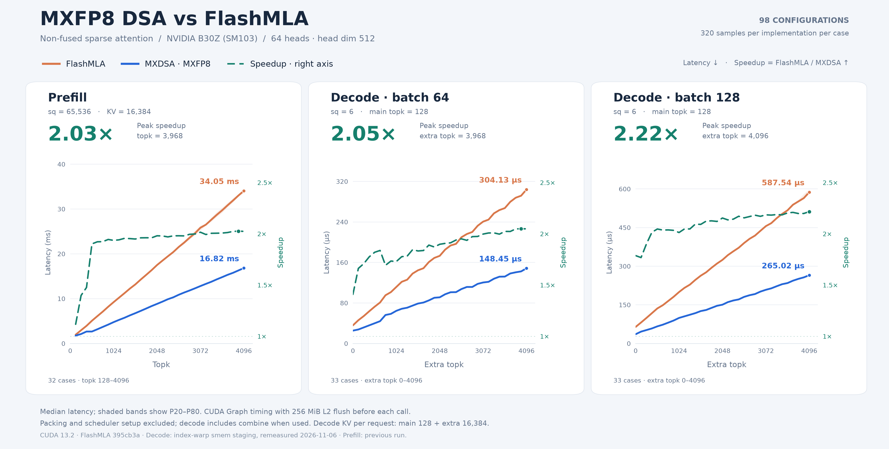

# MXDSA

MXDSA 是面向 NVIDIA Blackwell GPU 的 **MXFP8 Deepseek Sparse Attention kernel**。

## 与 FlashMLA 的速度对比

在 NVIDIA B30Z（SM103）上，与 FlashMLA 的 **non-fused、head64、head dim 512** 路径比较，已记录测试中的最高加速如下。加速比为 `FlashMLA 延迟 / MXDSA 延迟`。

| 场景 | 测试范围 | 最高加速 | 对应位置 |
| --- | --- | ---: | --- |
| Prefill，sq = 65,536 | topk = 128–4,096 | **2.03×** | topk = 3,968 |
| Decode，batch = 64，sq = 6 | extra topk = 0–4,096 | **2.05×** | extra topk = 3,968 |
| Decode，batch = 128，sq = 6 | extra topk = 0–4,096 | **2.22×** | extra topk = 4,096 |



实线为延迟，绿色虚线为加速比（右轴），阴影为 P20–P80。图中标注的是各组的**最高加速比**。

### 测试条件

- **硬件与软件**：NVIDIA B30Z，148 SM；CUDA 13.2，PyTorch 2.13.0+cu132。
- **Prefill**：sq = 65,536，KV 长度 = 16,384；topk 从 128 到 4,096，步长 128。
- **Decode**：batch = 64 / 128，sq = 6；每个请求的主 KV 长度和主 topk 均为 128，extra KV 长度为 16,384；extra topk 从 0 到 4,096，步长 128。总 topk 为 `128 + extra topk`。

## 构建与使用

需要 Blackwell GPU、支持 `sm_100f` / `sm_103f` 的 CUDA Toolkit 和支持 C++20 的编译器。构建 Python 扩展还需要兼容的 PyTorch；上述测试环境使用 CUDA 13.2。

```bash
# 构建 PyTorch 扩展：build/mxdsa_ext.so
./build.sh

# 或构建独立 CUDA 库：build/cuda/libmxdsa.so
./build.sh --cuda-only
```

可通过 `CUDA_HOME`、`PYTHON`、`BUILD_DIR` 指定工具链和输出目录。Python 调用示例见 [tests/benchmark.py](tests/benchmark.py)，输入打包辅助函数见 [tests/mxfp8_test_utils.py](tests/mxfp8_test_utils.py)。

扩展提供两个入口：

| 接口 | 用途 |
| --- | --- |
| `dual_mxfp8_head64_sparse_prefill_fwd` | Prefill，返回输出、max logits 和 log-sum-exp |
| `dual_mxfp8_sparse_decode_fwd` | Decode，返回输出、log-sum-exp 和可复用的调度信息 |

Q/KV 使用仓库约定的 `uint8` 打包格式，包含 E4M3 数据和 UE8M0 scale；KV scale 存放在数据区尾部，不能直接用普通浮点 tensor 替代。V 的 scale 需在两个 256 维分段内满足 token scale × dimension scale 的 rank-1 约定，并通过 `w1` / `w2` 传入对应维度 scale。Prefill 的相邻两个 query 共用一行索引，索引形状为 `[sq / 2, 1, topk]`，sq 必须为正偶数，topk 必须为 64 的正整数倍。具体参数与检查见 [Python bindings](csrc/bindings/binding.cpp)。


## 致谢

感谢 [FlashMLA](https://github.com/deepseek-ai/FlashMLA) 

感谢 [NVIDIA CUTLASS](https://github.com/NVIDIA/cutlass)

本项目的原创代码采用 [MIT License](LICENSE)，版权归 dingirsu 所有。来自 DeepSeek 和 NVIDIA CUTLASS 的代码分别遵循 [LICENSE.deepseek](LICENSE.deepseek) 和 [LICENSE.cutlass](LICENSE.cutlass) 中的许可条款，并保留原版权声明。
